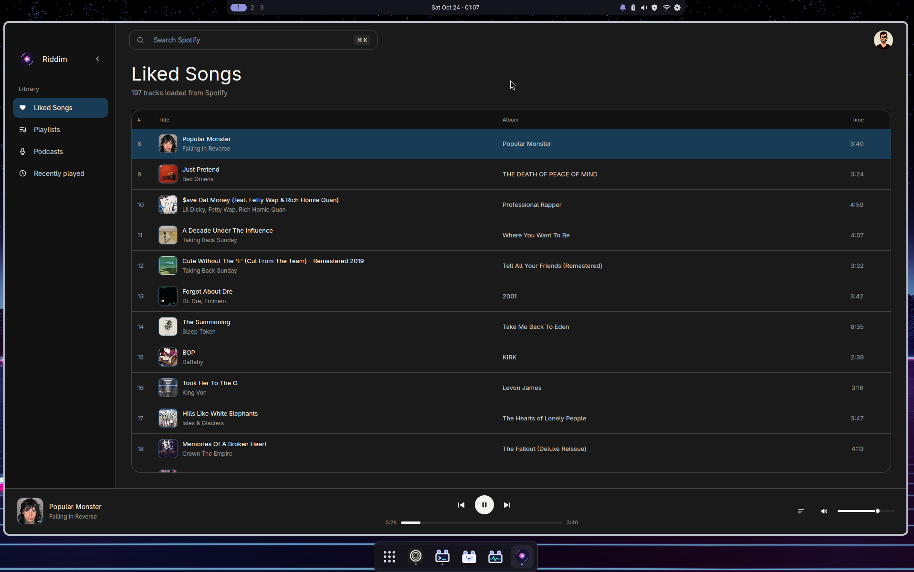

<p align="center">
  
</p>

<h1 align="center">Riddim</h1>

<p align="center">
  A minimal Spotify player for Linux.<br>
  Native, responsive, and typically uses around 120 MB of RAM.
</p>

<p align="center">
  <a href="LICENSE"></a>
</p>



## Features

- Search tracks and playlists
- Play music locally with queue, history, and radio
- Browse native artist and album pages
- Pin playlists to the sidebar
- Now Playing and media key controls through MPRIS
- Light, dark, and system appearances
- Persistent playback and library state

## Built With

**Rust** + **GPUI** + **Spotify Soloist** + **rspotify** + **SQLite**

GPUI renders the native GPU-accelerated interface, Spotify's official Soloist
daemon handles playback, rspotify connects to the Spotify Web API, and SQLite
keeps local state.

## Requirements

Linux with Spotify Premium. Riddim downloads Spotify's Soloist playback
daemon by itself and keeps it updated. Playback goes through ALSA, which
PipeWire and PulseAudio servers provide. A desktop keyring (GNOME Keyring,
KWallet, or another Secret Service provider) stores Spotify credentials. A
Vulkan driver renders the interface.

## Set Up Spotify

On first launch, Riddim walks you through creating a Spotify developer app
and entering its Client ID plus a Soloist API key. Client IDs are public;
Riddim never needs your client secret.

Spotify then asks you to approve Riddim once in the browser — for your
library, under your developer app, redirecting to
`http://127.0.0.1:8888/callback` (a local callback server Riddim runs
momentarily; nothing is served to the network). Playback pairs separately,
once, by picking **riddim** in the device picker of any Spotify app.

The full walkthrough, including what to do when the browser does not open,
Spotify rejects a redirect, or no keyring is running, is in
[`docs/spotify-setup.md`](docs/spotify-setup.md).

## Run From Source

kumaOS is atomic and ships no host toolchain, so cargo runs inside a podman
container. The first build creates `localhost/riddim-dev` from
[`containers/riddim-dev.containerfile`](containers/riddim-dev.containerfile);
rustup and the cargo registry live in named volumes, so later builds are
incremental. On any other Linux, the container works the same way and a plain
`cargo build` works too, given the usual GPUI dev packages (vulkan, wayland,
xkbcommon, fontconfig, freetype, ALSA, OpenSSL).

```sh
./scripts/build.sh build            # debug build, installs to ~/.local/bin/riddim
./scripts/build.sh build --release
./scripts/build.sh test             # 136 unit tests
./scripts/build.sh clippy --all-targets
```

Developers can skip the setup screen by setting `SPOTIFY_CLIENT_ID` at launch
(the script passes it through to the container):

```sh
SPOTIFY_CLIENT_ID="your-client-id" ./scripts/build.sh build
riddim
```

## Origin

Riddim is a Linux port of [Cadence](https://github.com/infomiho/cadence) by
Miho, a Spotify player for macOS. Same engine, same design; the platform
plumbing differs. The mark and interface icons are riddim's own artwork.

## License

[MIT](LICENSE)
